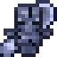
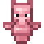
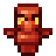
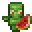
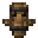

This mod is designed specifically for the [Dungeon Train modpack](https://modrinth.com/modpack/bEFyz3ji) / [mod](https://modrinth.com/mod/dungeon-train), but can be used independently.

## What it does

Dungeon Totems adds Totems of Undying that still save your life, but leave a curse behind. Each one pops just like the vanilla totem: you stay alive on half a heart with Regeneration, Absorption and Fire Resistance (the Void, Feather and Boom Totems skip Fire Resistance). Then the curse starts.

| | Totem | After it saves you |
|---|---|---|
|  | Totem&nbsp;of&nbsp;Weakness | Weakness for 20 minutes |
|  | Totem&nbsp;of&nbsp;Fatigue | Mining Fatigue II for 20 minutes |
|  | Totem&nbsp;of&nbsp;Heartbreak | 2 fewer hearts for 20 minutes |
|  | Totem&nbsp;of&nbsp;Blindness | Blindness for 30 seconds |
|  | Totem&nbsp;of&nbsp;Morphing | For 30 seconds you become a random animal, with its size, speed, health, attacks and moves. Monsters leave you alone. See Morphing below |
|  | Totem&nbsp;of&nbsp;Zombification | You become a zombie, and iron and snow golems hunt you. Get Weakness, then eat a golden apple within 10 minutes, like curing a zombie villager, or die |
|  | Totem&nbsp;of&nbsp;Rage | Kill 3 players or Player Mobs within 15 minutes, or die |
|  | Totem&nbsp;of&nbsp;Pacifism | Hurt anything within 20 minutes and you die |
|  | Totem&nbsp;of&nbsp;Melon&nbsp;Diet | Eat anything but melon within 20 minutes and you die |
|  | Totem&nbsp;of&nbsp;Restraint | Open a chest, barrel or ender chest within 20 minutes and you die |
|  | Totem&nbsp;of&nbsp;Loneliness | Make 3 friends within 10 minutes, or die. A friend is a Player Mob you swap gifts with |
|  | Void&nbsp;Totem | Only saves you from the void. It teleports you like a chorus fruit, onto ground near where you fell. In Dungeon Train it puts you back on the train |
|  | Feather&nbsp;Totem | Only saves you from falling |
|  | Boom&nbsp;Totem | Only saves you from explosions |

- **Evokers drop them.** An evoker drops one at random instead of the vanilla Totem of Undying. Its emeralds are unchanged.
- **Hold it in either hand.** A vanilla totem in hand is used first.
- **Curses stack.** A later pop never clears an earlier curse. The same curse again goes up a level with a fresh timer, and curses come back after you respawn.
- **Milk won't save you.** It doesn't lift the Morphed, Zombified or Rage curses.
- **No Player Mobs?** Villagers stand in: Rage counts villager kills, and Loneliness counts a villager you trade with, feed or cure.

## Morphing

The Totem of Morphing turns you into one of 42 mobs, seen in third person. Where you die decides the pool:

- **On land or in the air:** cows, pigs, sheep, chickens, rabbits, foxes, goats, llamas, pandas, polar bears, wolves, horses, donkeys, mules, cats, ocelots, mooshrooms, frogs, turtles, armadillos, camels, sniffers, snow golems, undead horses, iron golems, bees, parrots, bats and allays. Some are much rarer than others.
- **Underwater:** cod, salmon, tropical fish, pufferfish, squid, glow squid, dolphins, axolotls and tadpoles. Water forms dry out on land.
- **In lava:** a strider, which walks on lava, or a zombified piglin, whom other zombified piglins treat as one of the pack.

Each form moves and fights like its mob. Goats ram, iron golems throw, bees sting once, llamas spit and frogs eat small slimes with their tongue. Horses gallop and jump high, camels can't jump, and cats take no fall damage. Bees, parrots, bats and allays fly; chickens flutter down.

Right-click with an empty hand for the animal's own move: chickens lay eggs, armadillos roll into their shell, camels dash, cats sit, bats hang, frogs croak, sniffers dig up seeds, snow golems throw snowballs, turtles lay eggs on sand, parrots imitate, axolotls play dead, pufferfish puff up, squid ink and dolphins leap. Creepers keep away from a cat, a dolphin speeds up nearby swimmers, and a mooshroom can be milked for stew.

## Setup

- NeoForge 1.21.1.
- Install it on both the server and every client. The client draws the morph forms.
- No config. Datapacks can change which totems evokers drop (item tag `balancedtotems:evoker_totems`), which animals you can turn into and how often (data map `balancedtotems:morph_forms`) and which kills count for Rage (`balancedtotems:rampage_targets`).
- It only talks to your own game: the server tells nearby players when a totem pops or someone changes form. Nothing is sent anywhere else.

## Licence

PolyForm Shield 1.0.0. Source: [GitHub](https://github.com/bh679/balancedtotems-mc).
